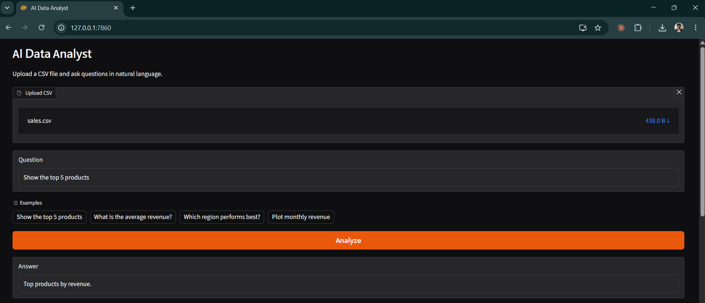
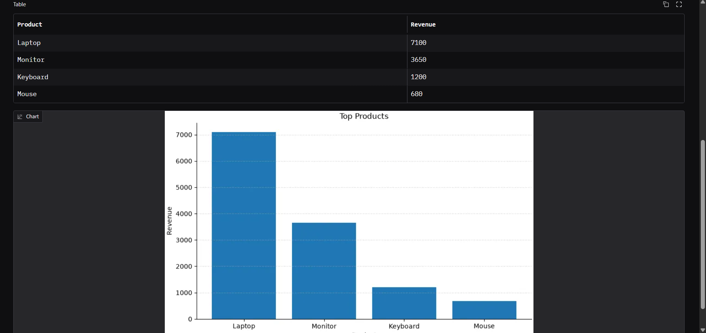

# AI Data Analyst Agent

An AI-powered data analysis assistant built with Python, Gradio, Pandas and OpenAI.

Upload a CSV with your sales data, ask a question in plain English and get back an answer, a table and a chart.

<p align="center">
  
  
</p>

You can ask things like:
- What are the top 5 products?
- Show average revenue.
- Which region performs best?
- Plot monthly revenue.

The goal of the project is to show a simple AI agent workflow: the LLM understands what the user wants, Pandas does the analysis, Matplotlib draws the chart and Gradio puts everything in a web page.

---

## Features

- CSV upload from the browser, with validation and clear error messages
- Questions in natural language, classified by an OpenAI model
- Average revenue, top products, best region and monthly revenue analysis
- Charts generated automatically with Matplotlib
- The UI opens in the browser as soon as the app starts
- Logging to console and to `logs/app.log`
- Configuration through a `.env` file (Pydantic Settings)
- Unit tests with pytest

---

## How it works

```
CSV upload ──> Data Loader (validation)
                     │
User question ──> OpenAI client ──> action (e.g. best_region)
                     │
                     v
              DataFrame Manager (Pandas)
                     │
                     v
              Chart Generator (Matplotlib)
                     │
                     v
          Answer + table + chart in Gradio
```

1. The user uploads a CSV file. It is checked for required columns, valid revenue values and valid dates.
2. The user asks a question.
3. The OpenAI client maps the question to one of the supported actions.
4. The agent runs the matching Pandas analysis.
5. If it makes sense, a chart is generated.
6. The answer, the table and the chart are shown in the interface.

The model is only used to understand the question: all the numbers are computed locally with Pandas, so the results don't depend on the LLM.

---

## Main components

| Component | File | What it does |
|---|---|---|
| Agent | `src/agent.py` | Gets the action from the LLM and runs the right analysis |
| Data Loader | `src/data_loader.py` | Loads the CSV and validates columns, revenue and dates |
| OpenAI Client | `src/llm/openai_client.py` | Classifies the question into a supported action |
| DataFrame Manager | `src/dataframe_manager.py` | Pandas analysis logic |
| Chart Generator | `src/chart_generator.py` | Line and bar charts with Matplotlib |
| UI | `src/ui.py` | Gradio interface |

Supported actions:

```
average_revenue
top_products
best_region
monthly_revenue
unknown
```

---

## CSV format

The file must contain these columns:

| Column | Type | Example |
|---|---|---|
| `Date` | date | `2025-01-03` |
| `Product` | text | `Laptop` |
| `Region` | text | `North` |
| `Revenue` | number | `1500` |

Example:

```csv
Date,Product,Region,Revenue
2025-01-03,Laptop,North,1500
2025-01-08,Monitor,East,800
2025-01-15,Mouse,South,200
```

The `data/` folder has a valid sample (`sales.csv`) and some broken files used to test the validation (`sales_dirty.csv`, `sales_empty.csv`, `sales_missing_columns.csv`, `sales_invalid.csv`).

---

## Installation

Requirements:
- Python 3.11+
- An OpenAI API key

Clone the repository:

```bash
git clone https://github.com/francescomv98/ai-data-analyst.git
cd ai-data-analyst
```

Create and activate a virtual environment:

```bash
python -m venv .venv

# Windows
.venv\Scripts\activate

# Linux / macOS
source .venv/bin/activate
```

Install the dependencies:

```bash
pip install -r requirements.txt
```

---

## Configuration

Create a `.env` file in the project root. Only the API key is required, the other values have defaults:

```env
OPENAI_API_KEY=your_openai_api_key

# optional
APP_NAME=AI Data Analyst
APP_VERSION=1.0.0
CHAT_MODEL=gpt-4.1-mini
LOG_DIRECTORY=logs
```

Relative paths (like `LOG_DIRECTORY`) are relative to the project root.

---

## Running the application

```bash
python main.py
```

The interface opens automatically in your default browser. If it doesn't, go to:

```
http://localhost:7860
```

---

## Testing

```bash
pytest
```

The tests cover CSV loading and validation, the analysis operations, chart generation and the OpenAI client (with the API mocked, so no key or network is needed for those).

---

## Project structure

```
ai-data-analyst/
├── src/
│   ├── config/
│   │   └── settings.py          # configuration from .env
│   ├── llm/
│   │   └── openai_client.py     # OpenAI wrapper
│   ├── utils/
│   │   └── logger.py            # logging setup
│   ├── agent.py                 # orchestration
│   ├── data_loader.py           # CSV loading and validation
│   ├── dataframe_manager.py     # analysis logic
│   ├── chart_generator.py       # charts
│   └── ui.py                    # Gradio interface
├── tests/                       # pytest tests
├── data/                        # sample CSV files
├── docs/images/                 # screenshots
├── logs/                        # app.log (created at startup)
├── .env
├── requirements.txt
├── main.py
└── README.md
```

---

## Tech stack

- **Python**, **Pandas** for data processing
- **OpenAI API** for understanding the questions
- **Gradio** for the web interface
- **Matplotlib** for the charts
- **Pydantic Settings** and **python-dotenv** for configuration
- **pytest** for testing
